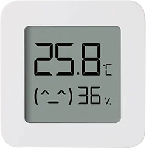

> [!CAUTION]
> This project is under active development. Some features are incomplete or work in progress.

# Skalyx
— hub for your weather sensors

Skalyx is a lightweight platform designed to collect data from weather sensors and visualize it in a single, beautiful dashboard. Built for local networks, it requires no cloud and keeps your data private.

# Installing
You need Python 3.12+ and Node.js 22+ (only for building the frontend).

[Frontend Installation](apps/client/README.md)

[Backend Installation](apps/server/README.md)

# Supported sensors
| Image | Name | Firmware | Guide |
| ----- | ---- | -------- | ----- |
|  | Xiaomi LYWSD03MMC | BLE | [Setup Guide](docs/sensors/lywsd03mmc.md)
